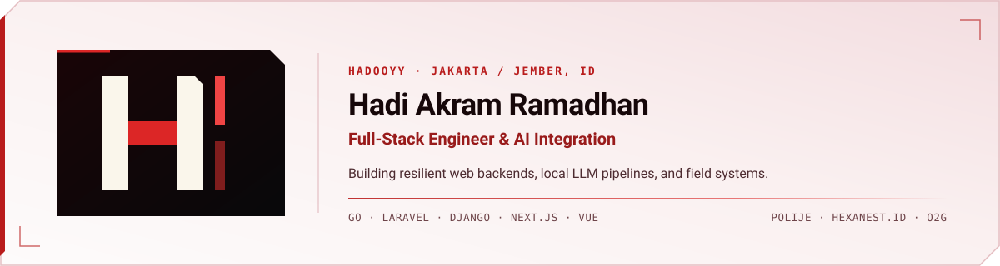

  <picture>
    <source media="(prefers-color-scheme: dark)" srcset="./assets/hero-dark.svg">
    
  </picture>

  Informatics Engineering at <strong>Politeknik Negeri Jember</strong> &middot; CMO &amp; Full-Stack Developer at <strong>Hexanest.id</strong> &middot; Builder at <a href="https://github.com/O2G-Main"><strong>O2G</strong></a>

  <a href="https://hadooyy.vercel.app/">Portfolio</a>
  &nbsp;&middot;&nbsp;
  <a href="https://linkedin.com/in/hadooyy">LinkedIn</a>
  &nbsp;&middot;&nbsp;
  <a href="https://canva.link/hadooyy-cv">Curriculum Vitae</a>
  &nbsp;&middot;&nbsp;
  <a href="https://github.com/O2G-Main">O2G Organization</a>

<picture>
  <source media="(prefers-color-scheme: dark)" srcset="./assets/divider-dark.svg">
  
</picture>

## Focus

- **Full-Stack & Backend Systems:** Architecting APIs and reactive web apps with Go, Laravel, Django, Next.js, and Vue.js designed to stay stable under heavy concurrent load.
- **Local & Applied AI:** Connecting local LLM runtimes (Ollama), browser audio/DOM capture, and messaging automation (Telegram, WhatsApp) into practical daily tools.
- **Background:** Former Full-Stack Web Developer & IT Support Intern at the Ministry of Trade of the Republic of Indonesia (2024); currently leading product engineering at Hexanest.id and building operational decision systems with O2G.

## Selected Projects

### Personal & Client Builds

| Project | Summary | Links | Stack |
| :--- | :--- | :--- | :--- |
| **suarlog** | Chrome MV3 extension for live meeting monitoring (Meet, Zoom Web, Teams) with real-time tab-audio capture, slide-change detection, BYO-AI analysis, and Telegram delivery | [Repository](https://github.com/Hadi-Akram-Ramadhan/suarlog) | JavaScript, Chrome APIs |
| **BSI-gamifikasi** | Phygital Islamic financial literacy ecosystem (*Sahabat Kecil BSI*, Sharia Young Leader Summit 2026) | [Repository](https://github.com/Hadi-Akram-Ramadhan/BSI-gamifikasi) | Next.js, TypeScript, Radix UI |
| **hadooyy-cli** | Portable Claude Code and Hermes agent environment setup bundling skills, plugin configs, MCP templates, and engineering rules | [Repository](https://github.com/Hadi-Akram-Ramadhan/hadooyy-cli) | CLI, Agent Tooling |
| **sibermu-haf** | Official landing page for Universitas Siber Muhammadiyah with custom design tokens and scroll choreography | [Repository](https://github.com/Hadi-Akram-Ramadhan/sibermu-haf) | Next.js, TypeScript, GSAP |
| **WFK-KNU** | Full-stack Laravel application powered by Reverb WebSockets, Sanctum auth, and Livewire | [Repository](https://github.com/Hadi-Akram-Ramadhan/WFK-KNU) | PHP, Laravel 12, Blade |
| **KPRI Polije WMS** | Warehouse management system for KPRI Politeknik Negeri Jember handling stock ledgers, inbound/outbound flows, and inventory audits | [Case Study](https://hadooyy.vercel.app/projects) | Laravel, Vue.js, MySQL |

### Built with O2G

| System | Role & Scope | Repositories | Stack |
| :--- | :--- | :--- | :--- |
| **AquaSeq** | Go eDNA qPCR & water-chemistry risk engine plus Expo mobile field app for shrimp pond health (GenoHack 2026) | [`AquaSeq-back`](https://github.com/O2G-Main/AquaSeq-back) [`AquaSeq-Mobile`](https://github.com/O2G-Main/AquaSeq-Mobile) [`AquaSeq-front`](https://github.com/O2G-Main/AquaSeq-front) | Go, Next.js, Expo |
| **Pantara** | Collaborative workload-balancing workspace with Go (chi, pgx, Redis) backend and Next.js frontend | [`PANTARA-v1`](https://github.com/O2G-Main/PANTARA-v1) [`PANTARA-BACK`](https://github.com/O2G-Main/PANTARA-BACK) | Go, Next.js, Python |
| **MilkGraph** | Go REST backend and Next.js simulation platform for dynamic dairy receiving traceability (PLAY IT! PLUS 2026) | [`Milkgraph-Back`](https://github.com/O2G-Main/Milkgraph-Back) [`Milkgraph`](https://github.com/O2G-Main/Milkgraph) | Go, Next.js, PostgreSQL |

<picture>
  <source media="(prefers-color-scheme: dark)" srcset="./assets/divider-dark.svg">
  
</picture>

## Tech Stack

  
  
  
  
  
  
  
  
  
   
  
  
  
  
  
  
  

## Contribution Activity

  <picture>
    <source media="(prefers-color-scheme: dark)" srcset="https://raw.githubusercontent.com/Hadi-Akram-Ramadhan/Hadi-Akram-Ramadhan/output/github-contribution-grid-snake-dark.svg">
    
  </picture>

<picture>
  <source media="(prefers-color-scheme: dark)" srcset="./assets/divider-dark.svg">
  
</picture>

  <strong>Hadi Akram Ramadhan</strong> (Hadooyy) &middot; Indonesia &middot; <a href="https://hadooyy.vercel.app/">hadooyy.vercel.app</a>

